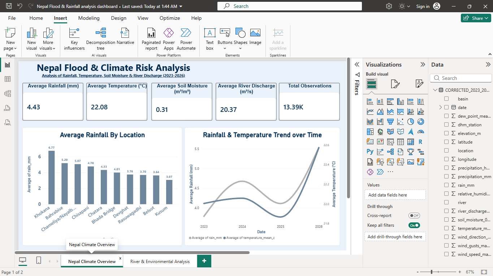
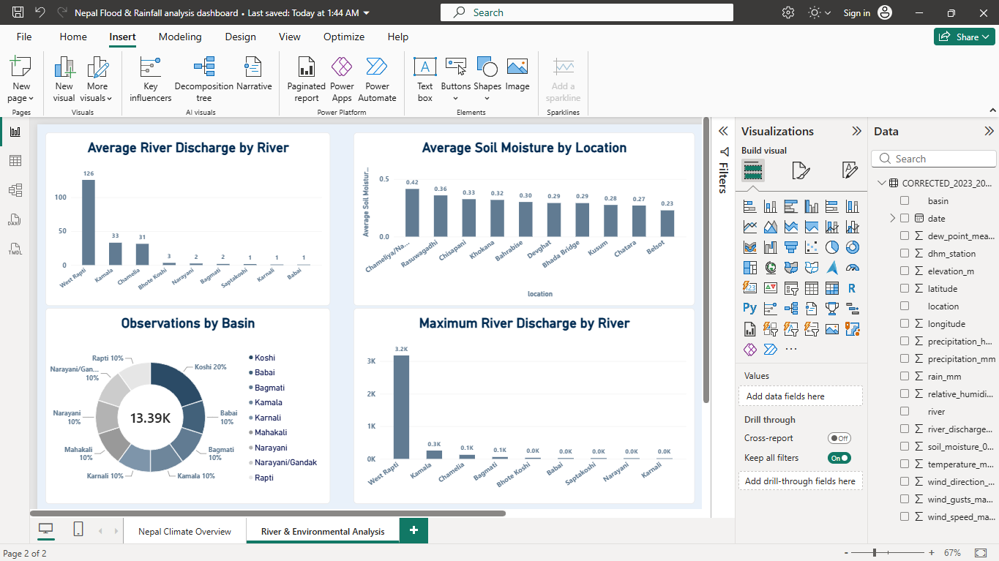

# Nepal Flood & Climate Risk Analysis (2023–2026)

## Project Overview

This project explores rainfall, temperature, soil moisture, river discharge, and other weather indicators across selected locations and river basins in Nepal.

The objective is to analyse climate patterns, compare environmental indicators across locations, and present the results through SQL queries and an interactive Power BI dashboard.

## Dataset

**Source:** Kaggle — Nepal Flood and Weather Dataset (2023–2026)

**Dataset Link:** https://www.kaggle.com/datasets/tejal5kunjir/nepal-flood-and-weather-dataset-2023-2026/data?select=nepal_flood_weather_dataset_kaggle_2023_2026.csv

- **File used:** `Nepal_rainfall.csv`
- **Records:** 13,390
- **Columns:** 19
- **Date coverage:** 1 January 2023 – 31 August 2026
- **Locations:** 10

The dataset contains weather and environmental measurements, including rainfall, temperature, humidity, soil moisture, river discharge, precipitation hours, and wind indicators.

## Tools & Technologies

- **Microsoft Excel:** Initial data inspection and quality checks
- **MySQL Workbench:** Data storage and SQL analysis
- **SQL:** Data querying, aggregation, grouping, and comparisons
- **Microsoft Power BI:** Interactive dashboard and data visualisation
- **CSV:** Dataset format

## Project Workflow

1. **Data Inspection:** Checked the CSV structure, date coverage, locations, and missing values.
2. **Data Preparation:** Reviewed the date column and prepared the dataset for SQL analysis.
3. **SQL Analysis:** Created queries to analyse climate trends, location-wise rainfall, soil moisture, river discharge, and weather indicators.
4. **Dashboard Development:** Built a two-page Power BI dashboard to present the key measurements and comparisons.
5. **Visual Analysis:** Used KPI cards, bar charts, a line chart, and a doughnut chart to communicate the results.

## SQL Analysis Questions

The project includes 15 analytical questions organised into five categories.

### 1. Climate and Time-Series Analysis
- How does rainfall change month by month?
- Which months have the highest and lowest average rainfall?
- How does rainfall vary from year to year?
- How does average temperature change over time?
- How does soil moisture vary over time?

### 2. Location-Wise Analysis
- Which locations have the highest and lowest average rainfall?
- Which locations have the highest average soil moisture?
- Which locations record the highest maximum rainfall?

### 3. River Discharge Analysis
- Which rivers have the highest average and maximum recorded discharge?
- What are the top 10 observations with the highest river discharge?

### 4. Rainfall and River Relationship
- How do average rainfall and river discharge compare across locations?
- Is there an observable relationship between rainfall and river discharge?

### 5. Additional Weather Indicators
- Which locations have the highest average precipitation hours?
- How does average humidity vary across rainfall categories?
- Which locations record the highest maximum wind gusts?

## Power BI Dashboard

The dashboard contains two pages.

### Page 1: Nepal Climate Overview

- KPI cards for average rainfall, average temperature, average soil moisture, average river discharge, and total observations
- Average Rainfall by Location
- Rainfall & Temperature Trend over Time

### Page 2: River & Environmental Analysis

- Average River Discharge by River
- Average Soil Moisture by Location
- Observations by Basin
- Maximum River Discharge by River

The report includes chart titles, axis titles, measurement units, and formatted visualisations to make the analysis easier to understand.

## Key Learning Outcomes

Through this project, I practised:

- Working with real-world-style environmental data
- Writing SQL queries using `SELECT`, `WHERE`, `GROUP BY`, `ORDER BY`, aggregate functions, and `CASE`
- Analysing trends and comparing multiple locations
- Building interactive reports in Power BI
- Presenting data through KPIs and visualisations
- Organising a data analytics project for a GitHub portfolio

## Important Limitations

This project explores potential flood-risk indicators rather than confirmed flood events.

- The dataset does not provide verified flood-event labels or confirmed disaster-impact figures.
- Rainfall and river discharge patterns do not, by themselves, prove that a flood occurred or that rainfall caused a particular discharge level.
- The year 2026 is incomplete in this dataset, so annual comparisons should account for the shorter observation period.

Therefore, this dashboard is an exploratory analytics project, not a validated flood-prediction or early-warning system.

## Repository Structure

```text
Nepal_flood_climate_analysis_report_Project/
├── README.md
├── Nepal_rainfall.csv
├── Nepal_Flood_Climate_Analysis_Queries.sql
├── Nepal Flood & Rainfall analysis dashboard.pbix
└── Nepal_project_Dashboard_Screenshots/
    ├── page-1-climate-overview.png
    └── page-2-river-environmental-analysis.png
```


## Dashboard Screenshots

### Page 1 — Nepal Climate Overview

(
### Page 2 — River & Environmental Analysis


## How to Use This Project

1. Download or clone the repository.
2. Import `Nepal_rainfall.csv` into MySQL Workbench.
3. Review and execute the queries in `Nepal_Flood_Climate_Analysis_Queries.sql`, ensuring the database and table names match your setup.
4. Open the `.pbix` file in Power BI Desktop.
5. Reconnect the report to your local data source if prompted.
6. Explore the charts and compare the available environmental indicators.

## Author

**Utkarsh Tiwari**  
B.Tech Computer Science & Engineering  
Aspiring Data Analyst
